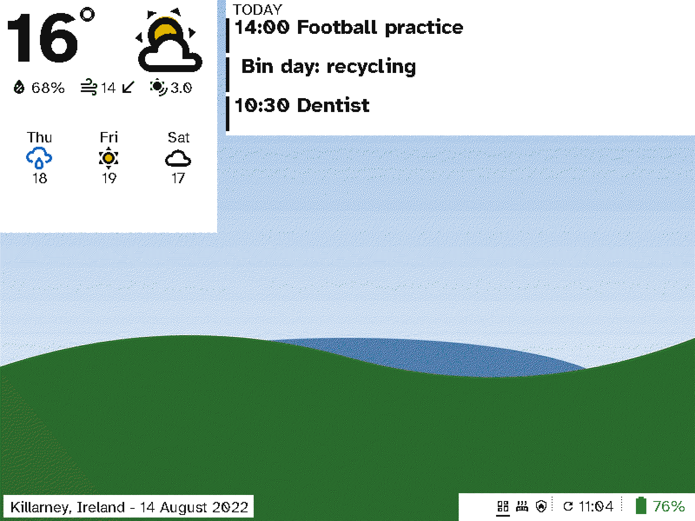

# Switchboard Board

**Your Switchboard screens at 13.3", in colour, on battery.**

Switchboard Board turns a **Seeed reTerminal E1004** into a big Switchboard wall display. The E1004 has a 13.3" Spectra 6 colour e-ink panel (1200 × 1600), three buttons, a battery and a temperature and humidity sensor. It shows the same screens as a [Switchboard Viewport](https://github.com/stumarti/Switchboard-Viewport), at twice the size so they read from across a lobby, a meeting room or a shop, with photos at the panel's full resolution.

<p></p>
<sub>The kitchen dashboard's Status screen as this firmware draws it on the E1004, landscape. Drawn on a computer by the host tests (test/host), from the same code that runs on the board.</sub>

<p></p>
<sub>A photo background from Immich at the panel's full 1600 × 1200, the screen's sections on cards over it.</sub>

> **Status: new and untested on hardware.** It builds and its drawing is tested, but nobody has run it on an E1004 yet. The panel driver is ported from a proven one (see [Credits](#credits)); if the picture is wrong or blank, please open an issue with the serial log.

## What it does

- **Every viewport layout, doubled to fill the panel.** The panel is 4:3, so screens are drawn 800 × 600 (600 × 800 in portrait) and doubled to its 1600 × 1200. Build them in [Switchboard Server](https://github.com/stumarti/Switchboard-Server)'s layout builder, exactly as for a viewport: weather, energy, heating, calendar, meeting rooms, guest Wi-Fi, messages and the rest. The builder previews them at a viewport's 800 × 480, so a board has 120 px more room at the bottom.
- **Photos at full resolution.** Text and icons are doubled, but photos aren't: a photo section or a photo background from Immich (and album art) is fetched at the panel's own resolution and drawn pixel for pixel, up to the whole 1600 × 1200.
- **Landscape or portrait, either way up.** Set **How it hangs** on the layout: landscape, portrait turned clockwise or anticlockwise, or upside down. In portrait the screen's columns become bands, one under the other.
- **Everything else is the viewport's.** Wi-Fi setup with your phone, pairing, quiet hours, the carousel, battery days on the server's Home page, the temperature and humidity in Home Assistant, and updates over Wi-Fi. This repository uses the viewport's code directly (the `viewport/` submodule), so a fix to a screen there reaches both displays.
- **Months on a charge.** It sleeps between refreshes and only redraws when something changed. A full refresh of the 13.3" panel takes about 20 seconds.

Coming later: full-resolution layouts made for the big panel, portrait, and photos from Immich beside live information.

## The buttons

| Button | Press | Hold (1 s) |
|---|---|---|
| **Refresh** | The first screen, fetched afresh | Wi-Fi setup |
| **Right** | Next screen | Fill the panel white |
| **Left** | Previous screen | The button card and device details |

The setup screens come from the viewport and call the Refresh button "the green button".

## Getting started

1. **Flash it** over USB-C (below), or from a release: `switchboard-board-<version>.bin` goes to offset 0.
2. **Put it on Wi-Fi** with your phone: scan the QR code on the panel. See [Setting up a viewport](https://stumarti.github.io/Switchboard/manual/viewport/setup.html); the E1004 is the same.
3. **Approve it** in Switchboard Server under **Viewports**, and give it a layout. It shows up as a viewport whose board is `e1004`.

### Updates over Wi-Fi

Releases attach `switchboard-e1004-app-<version>.bin` and its checksum. In Switchboard Server, **Settings → Updates → Sources**, add `stumarti/Switchboard-Board`. Then its releases can be added and rolled out to your E1004 boards the same way as for viewports and remotes. A board is only ever offered builds for `e1004`.

## Building

```sh
git clone --recurse-submodules https://github.com/stumarti/Switchboard-Board.git
cd Switchboard-Board
pio run -e e1004 -t upload -t monitor
```

The serial log is on the board's UART (pins 43/44), as on the E1002.

**Which way up.** Set it on the layout (**How it hangs**). The firmware takes landscape to be the panel turned clockwise from how Seeed draws it upright (`PANEL_LANDSCAPE 1`). If a landscape layout comes out upside down, build with `-DPANEL_LANDSCAPE=3`, or pick **Landscape, upside down**.

### Host tests

```sh
test/host/run.sh
```

Builds the frame code and the viewport's screen drawing with g++ and:
- checks the packing (two pixels a byte), every way up (every pixel lands on its own panel pixel), the doubling and full-resolution pictures;
- draws every viewport fixture screen as this board shows it, into `test/host/out/` as it hangs (portrait fixtures 1200 × 1600), with full-resolution photos from `test/fixtures/pictures`.

CI runs these and a PlatformIO build on every push.

## How it's put together

| | |
|---|---|
| `viewport/` | [Switchboard Viewport](https://github.com/stumarti/Switchboard-Viewport) as a submodule: everything except its E1002 display and hardware files |
| `src/config.h` | The viewport's `config.h`, with the E1004's pins |
| `src/board/ed2208.cpp` | The panel driver: two controllers, each driving half of the 1200 × 1600 panel |
| `src/board/frame.cpp` | The 960 KB frame in PSRAM, turned as it hangs; the 2× canvas the screens draw on, and full-resolution pictures |
| `src/board/display.cpp` | The viewport's `display.h`: draw, send, refresh, sleep |
| `src/board/hw.cpp` | The viewport's `hw.h`: buttons, battery, SHT40, LED, deep sleep |

To move to a newer viewport: `cd viewport && git pull origin main`, then commit the submodule.

## Credits

The panel driver (`src/board/ed2208.cpp`) and the E1004's pin assignments are ported from [esp32-photoframe](https://github.com/aitjcize/esp32-photoframe) by Wei-Ning Huang, MIT licensed. Its initialisation values come from the panel maker's reference code. See `LICENSE`.

## Licence

MIT. See `LICENSE`.
